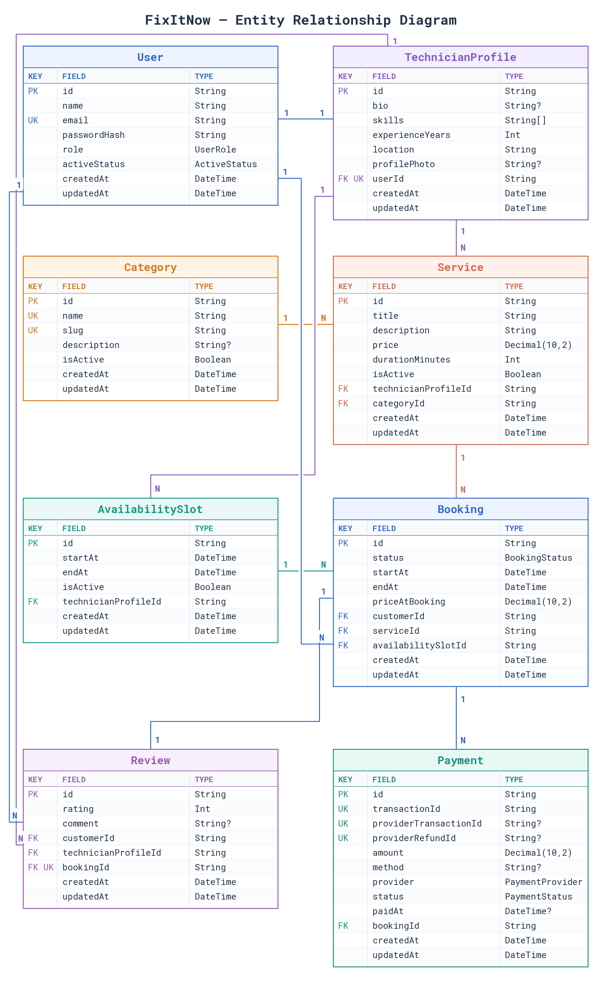

# FixItNow Backend Server

## 1. Introduction

FixItNow is a service booking API. Customers can find technicians, book services, pay online, and leave reviews. Technicians can manage their profiles, services, availability, and bookings. Admins can manage categories, users, and bookings.

## 2. Live Link

[Live API documentation](https://ph-l2-a4-fix-it-now-banckend-server-tau.vercel.app/docs/)

## 3. Project Structure

```text
FixItNow-backend-server/
├── .env.example
├── .gitignore
├── api/
│   └── index.js
├── docs/
│   ├── adminService.md
│   ├── authService.md
│   ├── availabilityService.md
│   ├── bookingService.md
│   ├── categoryService.md
│   ├── DatabaseSchema.md
│   ├── DatabaseSchema.png
│   ├── dataFlow.png
│   ├── paymentService.md
│   ├── reviewService.md
│   ├── serviceService.md
│   ├── Stripe.md
│   └── technicianService.md
├── package-lock.json
├── package.json
├── prisma.config.ts
├── prisma/
│   ├── migrations/
│   │   ├── 20260926134949_init/
│   │   │   └── migration.sql
│   │   ├── 20261010071235_add_fixitnow_models/
│   │   │   └── migration.sql
│   │   ├── 20261011141154_add_refund_tracking/
│   │   │   └── migration.sql
│   │   ├── 20261011141838_add_refund_failed_status/
│   │   │   └── migration.sql
│   │   └── migration_lock.toml
│   ├── models/
│   │   ├── availabilitySlot.prisma
│   │   ├── booking.prisma
│   │   ├── category.prisma
│   │   ├── enums.prisma
│   │   ├── payment.prisma
│   │   ├── review.prisma
│   │   ├── service.prisma
│   │   ├── technicianProfile.prisma
│   │   └── user.prisma
│   ├── schema.prisma
│   └── seed.ts
├── public/
│   └── .gitkeep
├── README.md
├── skills-lock.json
├── src/
│   ├── app.ts
│   ├── config/
│   │   └── index.ts
│   ├── lib/
│   │   ├── pino_logger.ts
│   │   ├── prisma.ts
│   │   └── stripe.ts
│   ├── middlewares/
│   │   ├── auth.ts
│   │   ├── globalErrorHandler.ts
│   │   ├── notFound.ts
│   │   ├── validateParams.ts
│   │   ├── validateQuery.ts
│   │   └── validateRequest.ts
│   ├── modules/
│   │   ├── admin/
│   │   │   ├── admin.controller.ts
│   │   │   ├── admin.docs.ts
│   │   │   ├── admin.interface.ts
│   │   │   ├── admin.route.ts
│   │   │   ├── admin.service.ts
│   │   │   └── admin.validation.ts
│   │   ├── auth/
│   │   │   ├── auth.controller.ts
│   │   │   ├── auth.docs.ts
│   │   │   ├── auth.interface.ts
│   │   │   ├── auth.routes.ts
│   │   │   ├── auth.services.ts
│   │   │   └── auth.validation.ts
│   │   ├── availability/
│   │   │   ├── availability.controller.ts
│   │   │   ├── availability.docs.ts
│   │   │   ├── availability.interface.ts
│   │   │   ├── availability.route.ts
│   │   │   ├── availability.service.ts
│   │   │   └── availability.validation.ts
│   │   ├── booking/
│   │   │   ├── booking.controller.ts
│   │   │   ├── booking.docs.ts
│   │   │   ├── booking.interface.ts
│   │   │   ├── booking.route.ts
│   │   │   ├── booking.service.ts
│   │   │   └── booking.validation.ts
│   │   ├── category/
│   │   │   ├── category.controller.ts
│   │   │   ├── category.docs.ts
│   │   │   ├── category.interface.ts
│   │   │   ├── category.route.ts
│   │   │   ├── category.service.ts
│   │   │   └── category.validation.ts
│   │   ├── payment/
│   │   │   ├── payment.controller.ts
│   │   │   ├── payment.docs.ts
│   │   │   ├── payment.interface.ts
│   │   │   ├── payment.route.ts
│   │   │   ├── payment.service.ts
│   │   │   ├── payment.validation.ts
│   │   │   └── providers/
│   │   │       ├── paymentProvider.factory.ts
│   │   │       └── stripe/
│   │   │           ├── stripe.controller.ts
│   │   │           ├── stripe.docs.ts
│   │   │           ├── stripe.provider.ts
│   │   │           ├── stripe.route.ts
│   │   │           └── stripe.webhook.ts
│   │   ├── review/
│   │   │   ├── review.controller.ts
│   │   │   ├── review.docs.ts
│   │   │   ├── review.interface.ts
│   │   │   ├── review.route.ts
│   │   │   ├── review.service.ts
│   │   │   └── review.validation.ts
│   │   ├── service/
│   │   │   ├── service.controller.ts
│   │   │   ├── service.docs.ts
│   │   │   ├── service.interface.ts
│   │   │   ├── service.route.ts
│   │   │   ├── service.service.ts
│   │   │   └── service.validation.ts
│   │   └── technician/
│   │       ├── technician.controller.ts
│   │       ├── technician.docs.ts
│   │       ├── technician.interface.ts
│   │       ├── technician.route.ts
│   │       ├── technician.service.ts
│   │       └── technician.validation.ts
│   ├── server.ts
│   └── utils/
│       ├── appError.ts
│       ├── catchAsync.ts
│       ├── jwt.ts
│       └── sendResponse.ts
├── swagger.ts
├── tsconfig.json
├── tsup.config.ts
└── vercel.json
```

## 4. Database Schema



## 5. Project Specification

| Item | Technology |
| --- | --- |
| Project | Express.js 5 with TypeScript |
| ORM | Prisma 7 |
| Database | PostgreSQL (Prisma Postgres) |
| Deployment | Vercel from GitHub |
| Form validation | Zod |
| Authentication | JWT and bcrypt |
| Payments | Stripe |
| API documentation | Swagger UI and OpenAPI |
| Logger | Pino |
| Build | tsup |

## 6. Features

| No. | Feature Name | Endpoint | Access |
| --- | --- | --- | --- |
| 1 | Register | `POST /api/auth/register` | Public |
| 2 | Login | `POST /api/auth/login` | Public |
| 3 | Refresh access token | `POST /api/auth/refresh-token` | Public |
| 4 | View own profile | `GET /api/auth/me` | Customer / Technician / Admin |
| 5 | Update own profile | `PATCH /api/auth/me` | Customer / Technician / Admin |
| 6 | List categories | `GET /api/categories` | Public |
| 7 | Add category | `POST /api/admin/categories` | Admin |
| 8 | List categories for admin | `GET /api/admin/categories` | Admin |
| 9 | Update category | `PATCH /api/admin/categories/:id` | Admin |
| 10 | List technicians | `GET /api/technicians` | Public |
| 11 | View technician | `GET /api/technicians/:id` | Public |
| 12 | View own technician profile, services, and availability | `GET /api/technician/profile` | Technician |
| 13 | Update technician profile | `PUT /api/technician/profile` | Technician |
| 14 | List services | `GET /api/services` | Public |
| 15 | Add service for admin approval | `POST /api/technician/services` | Technician |
| 16 | Update, pause, resume, or withdraw own service | `PATCH /api/technician/services/:id` | Technician |
| 17 | Search service suggestions | `GET /api/technician/services/suggestions` | Technician |
| 18 | Set availability | `PUT /api/technician/availability` | Technician |
| 19 | Block availability slot | `PATCH /api/technician/availability/:id/block` | Technician |
| 20 | Create booking | `POST /api/bookings` | Customer |
| 21 | List own bookings | `GET /api/bookings` | Customer |
| 22 | View own booking | `GET /api/bookings/:id` | Customer |
| 23 | Cancel booking | `PATCH /api/bookings/:id/cancel` | Customer |
| 24 | List assigned bookings | `GET /api/technician/bookings` | Technician |
| 25 | Update booking status | `PATCH /api/technician/bookings/:id` | Technician |
| 26 | Start payment | `POST /api/payments/create` | Customer |
| 27 | List own payments | `GET /api/payments` | Customer |
| 28 | View own payment | `GET /api/payments/:id` | Customer |
| 29 | List technician payments and shares | `GET /api/technician/payments` | Technician |
| 30 | Submit review | `POST /api/reviews` | Customer |
| 31 | List users | `GET /api/admin/users` | Admin |
| 32 | Update user status | `PATCH /api/admin/users/:id` | Admin |
| 33 | List all bookings | `GET /api/admin/bookings` | Admin |
| 34 | List all payments and revenue shares | `GET /api/admin/payments` | Admin |
| 35 | List customer feedback | `GET /api/admin/feedbacks` | Admin |
| 36 | List services for moderation | `GET /api/admin/services` | Admin |
| 37 | Approve, reject, pause, resume, or delete service | `PATCH /api/admin/services/:id` | Admin |
| 38 | Receive Stripe events | `POST /api/payments/webhook` | Stripe |
| 39 | Payment success return | `GET /api/payments/return/success` | Public |
| 40 | Payment cancel return | `GET /api/payments/return/cancel` | Public |
| 41 | Check server and database health | `GET /health` | Public |

## 7. Data Flow


## 8. Documentation & Learn

- [Authentication service](docs/authService.md)
- [Admin service](docs/adminService.md)
- [Availability service](docs/availabilityService.md)
- [Booking service](docs/bookingService.md)
- [Category service](docs/categoryService.md)
- [Payment service](docs/paymentService.md)
- [Review service](docs/reviewService.md)
- [Service service](docs/serviceService.md)
- [Technician service](docs/technicianService.md)
- [Stripe payment flow](docs/Stripe.md)
- [Database schema notes](docs/DatabaseSchema.md)

## 9. Project Development

Completed by Ahmad Zubayer during the Next Level Development course at Programming Hero.

## 10. Use of AI

Codex was used for formatting, brainstorming, error fixes, and code snippets in parts of this project.
