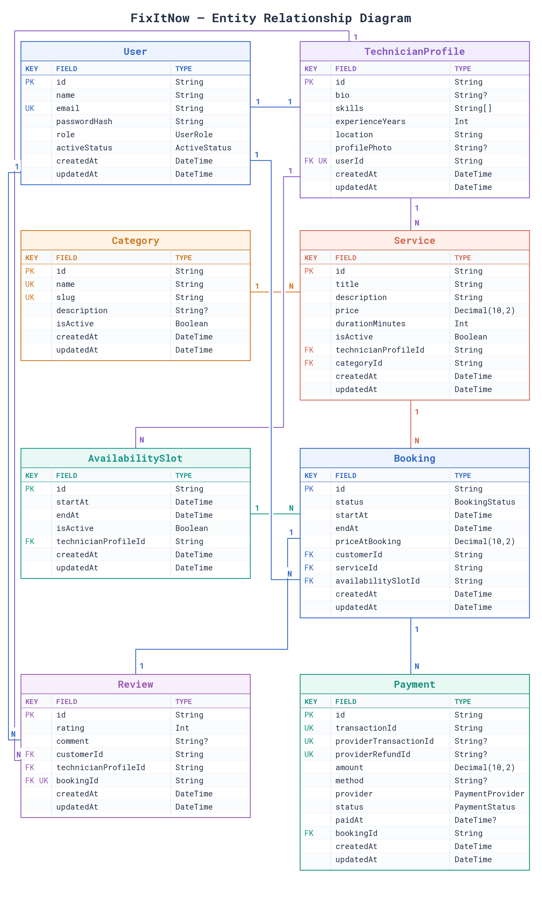

# Database schema

## Detailed ER diagram

## Defaults and statuses

- Every model's `id` defaults to a UUID. Every `createdAt` defaults to the current time, and every `updatedAt` changes automatically when Prisma updates the row.
- `User.role` defaults to `CUSTOMER`; `User.activeStatus` defaults to `ACTIVE`.
- `TechnicianProfile.experienceYears` defaults to `0`.
- `Category.isActive`, `Service.isActive`, and `AvailabilitySlot.isActive` default to `true`.
- `Booking.status` defaults to `REQUESTED`; `Payment.status` defaults to `PENDING`.

| Enum                | Allowed values                                                                                             |
| ------------------- | ---------------------------------------------------------------------------------------------------------- |
| `UserRole`        | `CUSTOMER`, `TECHNICIAN`, `ADMIN`                                                                    |
| `ActiveStatus`    | `ACTIVE`, `BLOCKED`                                                                                    |
| `BookingStatus`   | `REQUESTED`, `ACCEPTED`, `DECLINED`, `PAID`, `IN_PROGRESS`, `COMPLETED`, `CANCELLED`         |
| `PaymentProvider` | `STRIPE`, `SSLCOMMERZ`                                                                                 |
| `PaymentStatus`   | `PENDING`, `COMPLETED`, `FAILED`, `CANCELLED`, `REFUND_PENDING`, `REFUND_FAILED`, `REFUNDED` |

## Database names and indexes

| Prisma model          | PostgreSQL table        |
| --------------------- | ----------------------- |
| `User`              | `User`                |
| `TechnicianProfile` | `technician_profiles` |
| `Category`          | `categories`          |
| `Service`           | `services`            |
| `AvailabilitySlot`  | `availability_slots`  |
| `Booking`           | `bookings`            |
| `Payment`           | `payments`            |
| `Review`            | `reviews`             |

Besides the primary and unique keys shown in the diagram, the schema defines these indexes for faster lookups:

- `Service`: `technicianProfileId`, `categoryId`.
- `AvailabilitySlot`: the pair `(technicianProfileId, startAt)`.
- `Booking`: `customerId`, `serviceId`, `availabilitySlotId`.
- `Payment`: `bookingId`.
- `Review`: `technicianProfileId`.

## Delete behavior and important boundaries

- Deleting a `User` cascades to its `TechnicianProfile` because that relation explicitly has `onDelete: Cascade`.
- Bookings explicitly restrict deletion of their customer, service, and availability slot. Payments restrict deletion of their booking. Reviews restrict deletion of their customer, technician profile, and booking.
- The schema does **not** enforce one booking per availability slot. Booking rules decide whether a slot can be claimed again.
- A booking does not have a direct `technicianProfileId`. Its technician is reached through the selected `Service` or `AvailabilitySlot`. The application must ensure those two point to the intended technician.
- `PaymentProvider` lists `SSLCOMMERZ`, but the provider factory currently implements only `STRIPE`.
