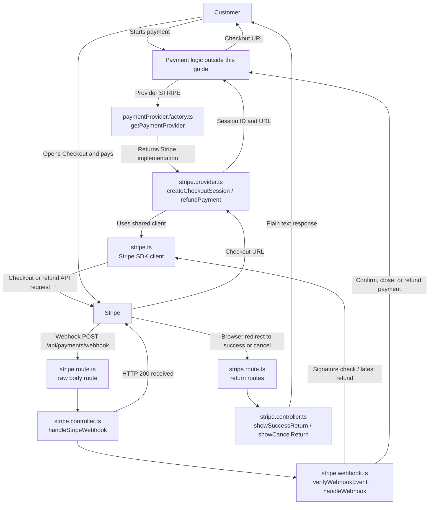

# Stripe files and payment provider

## Files at a glance

| File | Location | Purpose |
| --- | --- | --- |
| `stripe.ts` | `src/lib/stripe.ts` | Creates the shared Stripe client. |
| `paymentProvider.factory.ts` | `src/modules/payment/providers/paymentProvider.factory.ts` | Chooses the requested payment provider. |
| `stripe.provider.ts` | `src/modules/payment/providers/stripe/stripe.provider.ts` | Creates checkouts and requests refunds. |
| `stripe.route.ts` | `src/modules/payment/providers/stripe/stripe.route.ts` | Connects Stripe URLs to controllers. |
| `stripe.controller.ts` | `src/modules/payment/providers/stripe/stripe.controller.ts` | Receives webhooks and browser returns. |
| `stripe.webhook.ts` | `src/modules/payment/providers/stripe/stripe.webhook.ts` | Verifies and handles Stripe events. |

## `stripe.ts`

Location: `src/lib/stripe.ts`

### Methods in this file

- None. This file creates and exports one Stripe client named `stripe`.

### File flow

1. **Start:** Read `STRIPE_SECRET_KEY` through the project config.
2. Create a Stripe SDK client with that secret key.
3. Export the client as `stripe`.
4. `stripe.provider.ts` uses it to call Stripe Checkout and Refund APIs.
5. `stripe.webhook.ts` uses it to verify events and retrieve refund details.

## `paymentProvider.factory.ts`

Location: `src/modules/payment/providers/paymentProvider.factory.ts`

### Methods in this file

- **`getPaymentProvider`** — Returns the implementation for a requested provider.

### `getPaymentProvider` flow

1. **Start:** Payment logic passes a `PaymentProvider` value to this method.
2. If the value is `STRIPE`, return `stripePaymentProvider` from `stripe.provider.ts`.
3. If the value is anything else, stop with a `501` error: that provider is not implemented.
4. The caller uses the returned provider's `createCheckoutSession` or `refundPayment` method.

**Why it exists:** The caller asks for a payment provider without needing to know which file implements it.

## `stripe.provider.ts`

Location: `src/modules/payment/providers/stripe/stripe.provider.ts`

### Methods in this file

- **`createCheckoutSession`** — Creates a Stripe Checkout page for a booking.
- **`refundPayment`** — Requests a refund for a Stripe payment.

### `createCheckoutSession` flow — **CRITICAL: external Stripe request**

1. **Start:** Payment logic calls this method through the provider returned by `getPaymentProvider`. The input contains the payment ID, booking ID, customer email, service title, amount, and currency.
2. If `SERVER_URL` is missing, stop. Stripe needs return URLs.
3. If the currency is not `BDT`, stop. This implementation supports BDT only.
4. Multiply the amount in taka by `100` to get poisha, the unit sent to Stripe.
5. If that number is not a safe positive integer, stop.
6. Remove a trailing `/` from `SERVER_URL` so the return URLs have the right shape.
7. Ask Stripe to create a Checkout Session. Send the customer email, service name, amount in poisha, booking ID, and payment ID.
8. Put the booking ID in both `client_reference_id` and session metadata. Put the payment ID in metadata too. The webhook later uses these values to identify the records.
9. Set the success and cancel URLs to this server's `/api/payments/return/...` endpoints.
10. If Stripe returns no Checkout URL, stop with an error.
11. Return the Stripe session ID as `providerTransactionId` and the Checkout URL as `checkoutUrl` to the payment logic.

### `refundPayment` flow — **CRITICAL: external Stripe request**

1. **Start:** Payment logic calls this method through the provider returned by `getPaymentProvider`. The input contains the saved Stripe session ID and local payment ID.
2. Retrieve the Checkout Session from Stripe using its session ID.
3. Read the session's `payment_intent`. If it is missing, stop because there is no Stripe payment to refund.
4. If `payment_intent` is a full object, take its ID; if it is already a string, use that string.
5. Ask Stripe to create a refund for that payment intent.
6. Send `fixitnow-refund-${paymentId}` as an idempotency key. Repeating this request with the same key helps avoid making a second refund for the same payment.
7. Return Stripe's refund ID and current refund status to the payment logic, which saves them in the database.

### Provider connection

1. This file exports `stripePaymentProvider`, an object containing both methods.
2. `paymentProvider.factory.ts` returns that object when the chosen provider is `STRIPE`.
3. Both methods use the shared client from `stripe.ts` to make Stripe API calls.

## `stripe.route.ts`

Location: `src/modules/payment/providers/stripe/stripe.route.ts`

### Methods in this file

- No named methods. This file registers one POST route and two GET routes.

### Route flow

1. **Start:** The app mounts `stripeWebhookRoutes` at `/api/payments/webhook` and `stripeReturnRoutes` at `/api/payments/return`.
2. When Stripe calls `POST /api/payments/webhook`, use `express.raw({ type: "application/json" })` to keep the body as raw bytes.
3. Pass that request to `stripeController.handleStripeWebhook` in `stripe.controller.ts`.
4. When a browser opens `GET /api/payments/return/success`, call `stripeController.showSuccessReturn`.
5. When a browser opens `GET /api/payments/return/cancel`, call `stripeController.showCancelReturn`.

**Why raw bytes matter:** Stripe signs the original request body. The webhook verifies that signature against those exact bytes.

## `stripe.controller.ts`

Location: `src/modules/payment/providers/stripe/stripe.controller.ts`

### Methods in this file

- **`handleStripeWebhook`** — Checks the incoming request and hands its event to the webhook handler.
- **`showSuccessReturn`** — Shows a message after Checkout sends the browser back on success.
- **`showCancelReturn`** — Shows a message after Checkout sends the browser back on cancellation.

### `handleStripeWebhook` flow

1. **Start:** `stripe.route.ts` forwards Stripe's POST request here.
2. Read the `stripe-signature` request header.
3. Check that the signature is a string and the request body is a `Buffer` of raw bytes. If either check fails, stop with a `400` error.
4. Pass the raw body and signature to `stripeWebhook.handleWebhook` in `stripe.webhook.ts`.
5. Wait for the webhook handler to finish.
6. Return HTTP `200` with `{ received: true }` to Stripe.
7. If any step throws an error, `catchAsync` forwards it to the app's error handler.

### `showSuccessReturn` flow

1. **Start:** Stripe redirects the customer's browser to `/api/payments/return/success`.
2. Return a plain message saying the payment was submitted and is being confirmed.
3. Do not change payment status here. The verified webhook handles that.

### `showCancelReturn` flow

1. **Start:** Stripe redirects the customer's browser to `/api/payments/return/cancel`.
2. Return a plain message saying the customer left Checkout.
3. Do not change payment status here. A verified Stripe event handles the final state.

## `stripe.webhook.ts`

Location: `src/modules/payment/providers/stripe/stripe.webhook.ts`

### Methods in this file

- **`verifyWebhookEvent`** — Checks that the incoming event was signed by Stripe.
- **`handleWebhook`** — Reads a verified event and sends its result to payment logic.

### `verifyWebhookEvent` flow — **CRITICAL: signature verification**

1. **Start:** `handleWebhook` gives this method the raw request body and `stripe-signature` header received by `stripe.controller.ts`.
2. If `STRIPE_WEBHOOK_SECRET` is missing, stop with a server configuration error.
3. Ask the Stripe SDK to construct an event from the raw body, signature, and webhook secret.
4. If Stripe rejects the signature, stop with a `400` error.
5. Otherwise, return the verified Stripe event to `handleWebhook`.

### `handleWebhook` flow — **CRITICAL: payment and refund state changes**

**Verify and identify the event**

1. **Start:** `stripe.controller.ts` gives this method the raw body and signature.
2. Call `verifyWebhookEvent`. Stop if verification fails.
3. Read the verified event type.

**If Stripe reports a refund update or failure**

1. If the type is `refund.updated` or `refund.failed`, read the refund ID from the event.
2. Retrieve the latest refund from Stripe using the shared client from `stripe.ts`.
3. Pass provider `STRIPE`, refund ID, and Stripe's current refund status to the payment logic's `updateRefundStatusIntoDB` method.
4. Stop handling this event.

**If Stripe reports a Checkout event**

1. Treat `checkout.session.completed` and `checkout.session.async_payment_succeeded` as possible success events.
2. Treat `checkout.session.async_payment_failed` and `checkout.session.expired` as closed events.
3. If the event is none of these, stop without changing anything.
4. Read `paymentId` and `bookingId` from Checkout Session metadata.
5. If either ID is missing, or `client_reference_id` does not match `bookingId`, stop with a `400` error.

**If Checkout failed or expired**

1. If Stripe says the session is already `paid`, stop. Do not close a paid payment.
2. Choose `CANCELLED` for an expired session or `FAILED` for an asynchronous payment failure.
3. Pass the IDs, provider, Stripe session ID, and chosen status to `closePendingPaymentIntoDB` in the payment logic.
4. Stop handling this event.

**If Checkout succeeded**

1. If Stripe does not say `payment_status: paid`, stop. A completed Checkout Session alone does not prove the money was paid.
2. If the total amount or currency is missing, stop with a `400` error.
3. Convert Stripe's amount from poisha back to taka by dividing by `100`.
4. Build the payment details: payment ID, booking ID, provider, Stripe session ID, amount, and currency.
5. Call `completePaymentIntoDB` in the payment logic to confirm the payment and booking.
6. If that method reports a `409` conflict, call `refundCancelledBookingPaymentIntoDB` with the same details. That method checks whether the booking was cancelled and, if so, requests a refund.
7. If another error happens, pass it upward. `stripe.controller.ts` then lets `catchAsync` forward it to the app's error handler.

## Stripe data flow

The browser return routes only show messages. The signed webhook is what drives payment and refund updates.
